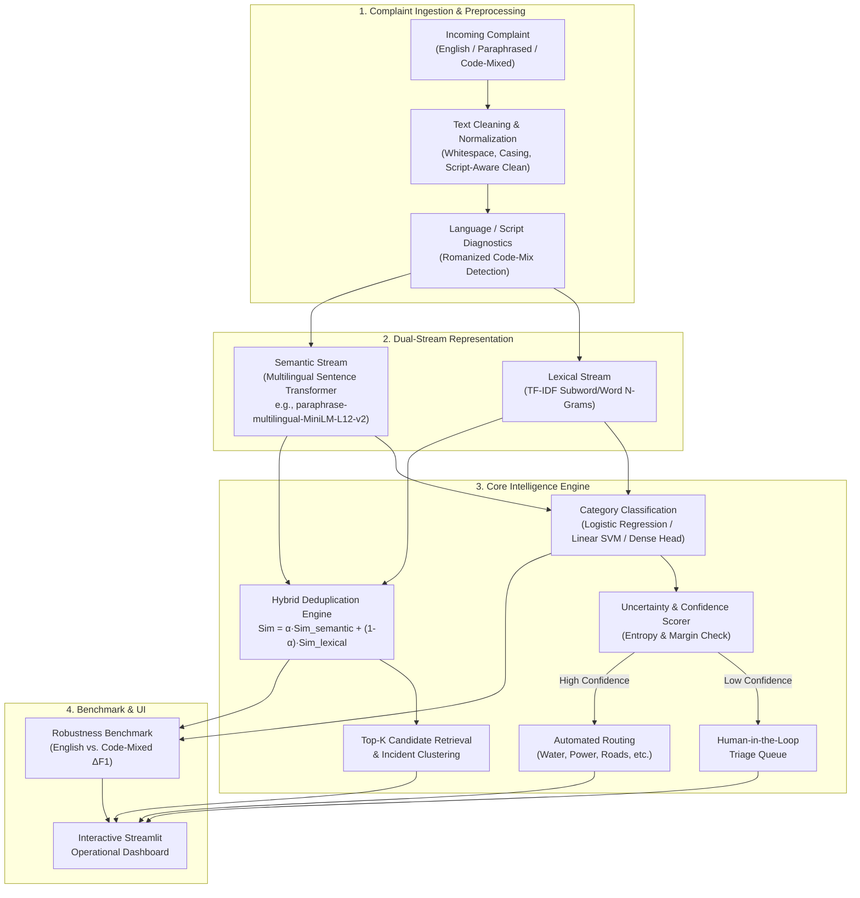
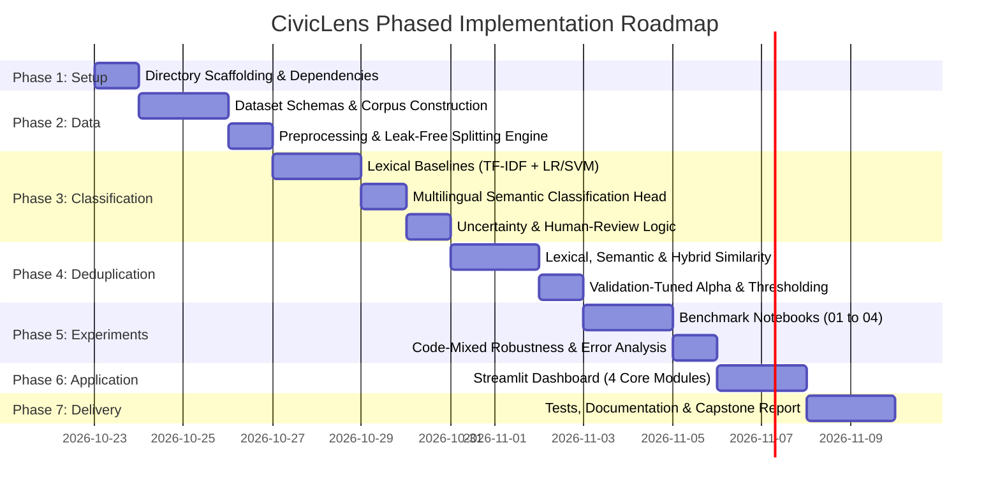
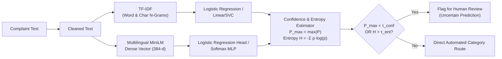
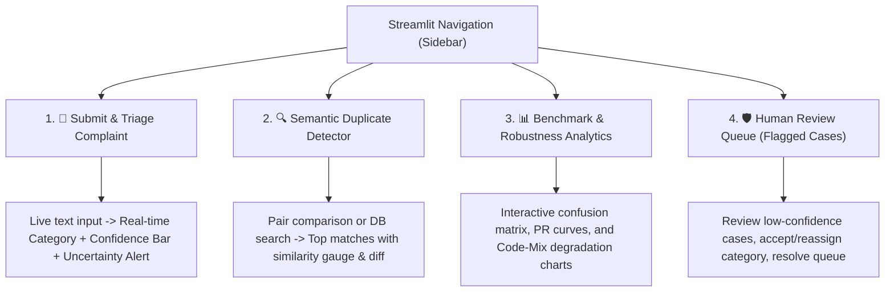

# CivicLens: Implementation Guide & Phased Development Blueprint

## Executive Overview
**CivicLens** is an NLP-driven research prototype designed to classify public service and institutional complaints, retrieve and rank semantic duplicates, and systematically benchmark model robustness against linguistic variations (standard English, colloquial abbreviations, syntactic paraphrasing, and Romanized/native code-mixed Indian languages).



---

## Technical Specifications & Stack

| Layer | Tooling / Library | Rationale |
| :--- | :--- | :--- |
| **Runtime Environment** | Python 3.11 | Modern typing, high stability with PyTorch and ML wheels |
| **Data Processing** | `pandas`, `numpy` | Tabular complaint indexing, vector math, split generation |
| **Lexical Modeling** | `scikit-learn` | TF-IDF (word + char n-grams), Logistic Regression, LinearSVC, metrics |
| **Dense Embeddings** | `sentence-transformers`, `torch` | Multilingual semantic representations (`paraphrase-multilingual-MiniLM-L12-v2`) |
| **Similarity Search** | Vectorized cosine similarity / BallTree | Sub-millisecond pairwise candidate retrieval |
| **Evaluation & Plotting** | `scikit-learn`, `matplotlib`, `seaborn` | Confusion matrices, Precision-Recall curves, error breakdown |
| **Interactive UI** | `streamlit` | Reactive web interface for live complaint triage, deduplication, and metrics |
| **Testing & Quality** | `pytest` | Unit tests for preprocessing, feature extraction, and similarity pipelines |

---

## Complete Phased Implementation Roadmap



---

### Phase 1: Repository Architecture & Dependency Management
**Goal**: Establish clean modular architecture, reproducible virtual environment, and baseline configuration.

#### 1. Target Directory Layout
```text
civiclens/
├── app.py                          # Streamlit interactive application
├── requirements.txt                # Pinned dependencies
├── README.md                       # Architectural documentation & quickstart
├── .gitignore                      # Git exclusion rules
├── IMPLEMENTATION_GUIDE.md          # Phased development blueprint & system architecture
├── data/
│   ├── README.md                   # Data documentation & annotation guidelines
│   ├── sample_complaints.csv       # Primary labeled complaint dataset
│   ├── code_mixed_eval.csv         # Held-out multilingual & code-mixed test set
│   └── complaint_pairs.csv         # Pairwise labeled duplicate ground truth
├── notebooks/
│   ├── 01_data_exploration.ipynb
│   ├── 02_baseline_classification.ipynb
│   ├── 03_semantic_similarity.ipynb
│   └── 04_robustness_evaluation.ipynb
├── src/
│   ├── __init__.py
│   ├── preprocessing.py            # Text cleaning, normalization, group-split
│   ├── classification.py           # TF-IDF, LR, SVM, Dense embedding classifiers
│   ├── similarity.py               # Lexical, Semantic, and Hybrid scorers
│   ├── evaluation.py               # Classification & deduplication evaluation
│   └── visualization.py            # Confusion matrices, PR curves, charts
├── models/
│   ├── README.md                   # Model artifact notes
│   ├── tfidf_vectorizer.joblib     # Serialized vectorizer
│   └── classifier_baseline.joblib  # Serialized baseline
├── results/
│   ├── metrics.csv                 # Automated benchmark table
│   └── figures/                    # Generated high-res evaluation plots
├── report/
│   └── report_outline.md           # Capstone dissertation & defense notes
└── tests/
    ├── __init__.py
    ├── test_preprocessing.py
    ├── test_classification.py
    └── test_similarity.py
```

#### 2. Key Deliverables
- [ ] Create repository folders (`data/`, `notebooks/`, `src/`, `models/`, `results/figures/`, `report/`, `tests/`).
- [ ] Craft `requirements.txt` with compatible versions:
  - `pandas`, `numpy`, `scikit-learn`, `joblib`
  - `sentence-transformers`, `torch`
  - `streamlit`, `matplotlib`, `seaborn`
  - `pytest`
- [ ] Verify test runner execution (`pytest tests/`).

---

### Phase 2: Data Engineering & Preprocessing Pipeline
**Goal**: Design high-quality, reproducible complaint datasets representing realistic municipal and campus scenarios across languages.

#### 1. Schema Specifications
- **`sample_complaints.csv`** (Primary Training & Evaluation):
  - `complaint_id` (str): e.g., `CMP-001`
  - `text` (str): Raw complaint description
  - `category` (str): One of 6 standardized domains:
    1. `Water supply` (contamination, pipe bursts, low pressure)
    2. `Electricity` (power outages, voltage fluctuations, sparking wires)
    3. `Sanitation` (garbage pile-ups, sewage overflow, public toilets)
    4. `Roads` (potholes, streetlights, broken footpaths, speed breakers)
    5. `Transport` (bus frequency, ticketing, reckless driving, route issues)
    6. `Campus facilities` (hostel amenities, lab maintenance, library HVAC)
  - `language_tag` (str): `en_formal`, `en_informal`, `code_mixed_hinglish`, `code_mixed_tanglish`, etc.
  - `incident_group_id` (str): Grouping ID ensuring semantic duplicates or rephrased versions of the same incident belong to the same split (preventing data leakage).

- **`complaint_pairs.csv`** (Deduplication Benchmark):
  - `pair_id` (str)
  - `complaint_1` (str)
  - `complaint_2` (str)
  - `is_duplicate` (int: 0 or 1)
  - `pair_type` (str): `exact_duplicate`, `lexical_paraphrase`, `semantic_paraphrase`, `code_mixed_pair`, `hard_negative_same_category`, `cross_category_negative`.

- **`code_mixed_eval.csv`** (Held-out Robustness Test):
  - Parallel test cases pairing standard English complaints with authentic code-mixed representations (e.g., Hinglish, Tanglish, colloquial Hindi/Tamil/Kannada in Latin script).

#### 2. Preprocessing Engine (`src/preprocessing.py`)
- Standardizing casing while preserving Romanized Dravidian / Indo-Aryan code-mix cues.
- Whitespace stripping, punctuation normalization, URL/phone/PII anonymization.
- Leakage-proof splitting function: `grouped_train_test_split(df, group_col='incident_group_id', test_size=0.2, random_state=42)`.

---

### Phase 3: Classification Modeling & Uncertainty Triage
**Goal**: Implement both lexical baselines and multilingual dense representations; build an uncertainty-aware decision layer.



#### 1. Baseline Models (`src/classification.py`)
- **Pipeline 1**: `TfidfVectorizer(ngram_range=(1,2), sublinear_tf=True)` + `LogisticRegression(class_weight='balanced')`.
- **Pipeline 2**: `TfidfVectorizer(analyzer='char_wb', ngram_range=(3,5))` + `LinearSVC(C=1.0)` calibrated via Platt scaling (`CalibratedClassifierCV`).
  - *Note*: Character n-grams are critical for code-mixed Romanized variations where phonetic spellings vary widely (e.g., *bijli*, *bijlee*, *bizzli*).

#### 2. Multilingual Semantic Classifier
- Embedding model: `sentence-transformers/paraphrase-multilingual-MiniLM-L12-v2` (compact, fast CPU inference, supports 50+ languages including Indo-Aryan and Dravidian scripts/transliterations).
- Dense feature extractor + tuned Logistic Regression head or Multi-Layer Perceptron.

#### 3. Uncertainty-Aware Human-in-the-Loop Protocol
- Calculate prediction confidence $C = \max_k P(y=k \mid x)$ and normalized predictive entropy:
  $$H(x) = -\sum_{k=1}^K P(y=k \mid x) \log_K P(y=k \mid x)$$
- Complaints with $C < \tau_{\text{confidence}}$ (e.g., 0.65) or $H > \tau_{\text{entropy}}$ (e.g., 0.50) are tagged with `status: "FLAGGED_FOR_HUMAN_REVIEW"`.

---

### Phase 4: Semantic & Hybrid Deduplication Engine
**Goal**: Accurately detect whether two submitted complaints describe the same underlying incident, even when expressed with different vocabulary or in code-mixed dialect.

#### 1. Similarity Formulations (`src/similarity.py`)
- **Lexical Similarity ($S_{\text{lex}}$)**:
  - Cosine similarity between character n-gram TF-IDF vectors or Token Jaccard overlap.
- **Semantic Similarity ($S_{\text{sem}}$)**:
  - Cosine similarity between normalized dense sentence embeddings:
    $$S_{\text{sem}}(u, v) = \frac{\mathbf{u} \cdot \mathbf{v}}{\|\mathbf{u}\| \|\mathbf{v}\|}$$
- **Hybrid Similarity ($S_{\text{hybrid}}$)**:
  $$S_{\text{hybrid}}(u, v) = \alpha \cdot S_{\text{sem}}(u, v) + (1 - \alpha) \cdot S_{\text{lex}}(u, v)$$
  where $\alpha \in [0.0, 1.0]$ is an empirically tuned balance parameter.

#### 2. Threshold Calibration on Validation Pairs
- Compute Precision, Recall, and F1 across threshold sweeps $\tau \in [0.30, 0.95]$.
- Select $\tau^*$ maximizing $F_1$ or bounded by minimum target precision (e.g., Precision $\ge 0.85$ to avoid false alarm incident mergers).

#### 3. Candidate Retrieval & Clustering
- Implement top-$K$ candidate search across existing active complaints in the same or related category.

---

### Phase 5: Experimental Benchmark & Robustness Analysis
**Goal**: Run reproducible experiments, generate scientific artifacts, and assess performance degradation under code-mixing.

#### 1. Systematic Benchmark Dimensions
| Experiment | Models Compared | Primary Metrics | Test Conditions |
| :--- | :--- | :--- | :--- |
| **Exp 1: Complaint Classification** | TF-IDF + LR, TF-IDF + SVM, Semantic + LR | Accuracy, Macro-F1, Per-class PR | Standard In-Distribution Test Set |
| **Exp 2: Deduplication** | Lexical Only, Semantic Only, Hybrid ($\alpha=0.7$) | Precision, Recall, F1, ROC-AUC | Paraphrased & Cross-variant Pairs |
| **Exp 3: Linguistic Robustness** | All Models | $\Delta F_1 = F_{1,\text{en}} - F_{1,\text{codemix}}$ | English vs Code-mixed Paired Test |
| **Exp 4: Uncertainty Filtering** | Raw Model vs Human-Gated Model | Accuracy on Accepted vs Rejection Rate | Sweep on $\tau_{\text{confidence}}$ |

#### 2. Notebook Execution & Artifact Generation
- `01_data_exploration.ipynb`: Corpus diagnostics, class frequencies, vocabulary overlap.
- `02_baseline_classification.ipynb`: Model training, hyperparameter tuning, baseline metrics.
- `03_semantic_similarity.ipynb`: Embedding visualization, threshold optimization curves.
- `04_robustness_evaluation.ipynb`: Code-mix degradation testing, confusion matrices, error tables saved to `results/metrics.csv` and `results/figures/`.

---

### Phase 6: Streamlit Operational Dashboard (`app.py`)
**Goal**: Deliver a cohesive, modern web interface demonstrating live complaint processing, duplicate clustering, and analytical metrics.



#### Key Application Capabilities:
1. **Submit & Triage Complaint**:
   - Single input box supporting English and Romanized Indian languages.
   - Shows predicted category, top-3 class probabilities, and a visual uncertainty warning banner when confidence is low.
2. **Duplicate Detection & Incident Matching**:
   - Compares the entered complaint against existing database complaints.
   - Highlights matching text fragments, hybrid score gauge, and duplicate verdict (Duplicate / Unique).
3. **Research & Evaluation Dashboard**:
   - Interactive model comparison dropdown (Baseline vs Semantic vs Hybrid).
   - High-res seaborn/matplotlib visual exports.
4. **Human Review Queue**:
   - Table of flagged complaints awaiting administrator verification with single-click triage actions.

---

### Phase 7: Quality Assurance, Documentation & Capstone Deliverables
**Goal**: Guarantee reproducibility, maintain code cleanliness, and prepare defense/viva assets.

- **Unit Tests (`tests/`)**:
  - `test_preprocessing.py`: Handles empty strings, unusual unicode, whitespace, and category verification.
  - `test_classification.py`: Checks vectorizer output dimensions and prediction shape.
  - `test_similarity.py`: Checks boundary cases ($S=1.0$ for identical text, $S \ge 0$ for divergent text).
- **Documentation**:
  - `README.md`: System overview, setup guide, architecture diagram, reproduction commands.
  - `data/README.md`: Licensing notes, annotation scheme, ethics statement.
  - `report/report_outline.md`: Comprehensive outline covering Problem Statement, Related Work, Methodology, Experiments, Discussion, and Ethical Considerations.

---

## Next Steps & Immediate Execution Order

To proceed efficiently, we can execute this roadmap step-by-step:
1. **Initialize Phase 1**: Set up directory structure, `requirements.txt`, and verify the local environment.
2. **Execute Phase 2**: Build the curated complaint datasets (`sample_complaints.csv`, `complaint_pairs.csv`, `code_mixed_eval.csv`) and implement `src/preprocessing.py`.
3. **Execute Phase 3 & 4**: Implement `src/classification.py` and `src/similarity.py`.
4. **Execute Phase 5**: Generate evaluation benchmarks, figures, and metrics.
5. **Execute Phase 6**: Build the complete interactive Streamlit application in `app.py`.
6. **Execute Phase 7**: Write unit tests, finalize documentation, and generate the capstone report outline.
